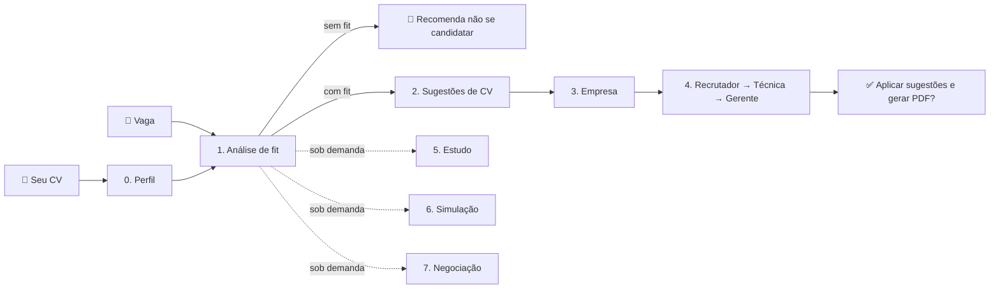

<div align="center">

# 🎯 prep-interview

**Seu coach de entrevistas para vagas de tecnologia fora do Brasil, rodando no Claude Code.**

Mande seu CV e o link da vaga: o agent analisa o fit, sugere ajustes no CV, pesquisa a empresa,
prepara você para cada fase do processo seletivo, simula a entrevista em inglês e ajuda a negociar a oferta.

[](https://claude.com/claude-code)
[](#-modelo-e-custo)
[](#-princípios)
[](LICENSE)

</div>

---

## ✨ O que ele faz

| | Etapa | O que você recebe |
|---|---|---|
| 👤 | **0. Perfil** | Um questionário único que monta seu perfil. Cada vaga depois só pergunta o que for novo |
| 📊 | **1. Análise de fit** | Nota de 0 a 100, requisito por requisito com evidência do seu CV, gaps e uma recomendação honesta: vale ou não se candidatar |
| 📝 | **2. Sugestões de CV** | Antes / Depois / Por quê, mantendo seu nível e sua voz. Nada é alterado sem você pedir |
| 🏢 | **3. Empresa** | Ramo, tamanho, receita, clientes, notícias, reputação, artigos de funcionários e a resposta para *"What do you know about us?"* |
| 🎤 | **4. Processo seletivo** | Recrutador (com faixa salarial pesquisada), entrevista técnica (com *trick questions* e live test) e gerente (soft skills) |
| 📚 | **5. Plano de estudo** | Os gaps viram um cronograma com mini-projetos até a data da entrevista |
| 🎭 | **6. Simulação ao vivo** | Uma pergunta por vez, em inglês, com nota e feedback de conteúdo e de inglês |
| 💰 | **7. Negociação** | Faixa de mercado, CLT × PJ × contractor e roteiro de contraproposta |

Funciona para **qualquer vaga de tecnologia**: dev, dados, DevOps/SRE, cloud, QA, segurança, produto.

## 🔄 Como funciona



## 🚀 Começando

**Pré-requisito:** [Claude Code](https://claude.com/claude-code) (plano Pro, Max ou chave de API).

```bash
git clone https://github.com/alemakray/prep-interview.git
cd prep-interview
claude
```

Dentro do Claude Code:

```text
/model sonnet
/prep-interview etapa 0                              # primeiro uso: monta seu perfil
/prep-interview inputs/cv/meu-cv.pdf <link-da-vaga>  # análise completa de uma vaga
```

O comando `/prep-interview` já vem no repositório (`.claude/skills/`) e fica disponível quando você abre o
Claude Code nesta pasta.

<details>
<summary><b>📦 Recomendado: instalar o <code>pdftotext</code></b></summary>

O agent lê o CV em PDF uma vez e guarda o texto em cache. Com o `pdftotext`, essa primeira leitura sai bem
mais barata (sem ele, cada página também vai como imagem).

```bash
sudo apt install -y poppler-utils   # Debian / Ubuntu / WSL
brew install poppler                # macOS
choco install poppler               # Windows (ou: scoop install poppler)
```

</details>

## 🧭 Comandos

| Comando | O que faz |
|---|---|
| `/prep-interview <cv> <vaga>` | Análise completa de uma vaga (etapa 1) e segue o fluxo |
| `/prep-interview --quick <cv> <vaga>` | Triagem rápida: nota, veredito e 3 maiores gaps em ~10 linhas |
| `/prep-interview --compare` | Tabela comparando todas as vagas já analisadas |
| `/prep-interview etapa N` | Roda a etapa N (0 a 7) na vaga mais recente |

> 💡 **Fluxo econômico:** rode `--quick` em várias vagas, depois `--compare`, e faça a análise completa só
> nas que valem a pena.

A vaga pode ser um link (Greenhouse, Lever, Workday, Ashby, site da empresa), PDF, DOC ou texto colado.
Alguns sites, como o LinkedIn, bloqueiam leitura automática: nesse caso, cole o texto.

## 🧠 Princípios

- **Zero invenção.** Nada de experiência, métrica ou cargo que não esteja no seu CV ou que você não tenha
  confirmado. Toda afirmação cita a evidência.
- **Honestidade sobre o fit.** Se a vaga não combina com você, o agent diz isso com educação e sugere vagas
  mais alinhadas. A decisão é sua.
- **Seu nível e sua voz.** As sugestões de CV não inflam cargos nem usam a fórmula "verbo + métrica + %".
  O resumo é ajustado de forma discreta, sem parecer feito para a vaga.
- **Inglês onde importa.** Toda pergunta e resposta de entrevista sai 100% em inglês; orientações e feedback
  ficam em português.
- **Memória entre vagas.** Tudo o que você responde é salvo no seu perfil e não é perguntado de novo.

## 💸 Modelo e custo

**Use o Sonnet** (`/model sonnet`). Ele roda bem todas as etapas pela metade do preço do Opus.

| Uso | Modelo |
|---|---|
| Todas as etapas, `--quick`, `--compare` | **Sonnet** (recomendado) |
| CV (etapa 2) e simulação (etapa 6) | Opus, opcional, para mais refinamento |
| Buscas e leitura de páginas | Haiku, automático |

**Custo estimado do processo completo (etapas 0 a 7) com chave de API:** cerca de US$ 1,50 a 2,50 no Sonnet,
ou US$ 3 a 5 no Opus. São estimativas; use `/cost` no fim da sessão para ver o valor real. Nos planos Pro e
Max não há cobrança por token: o custo é o consumo do seu limite de uso.

<details>
<summary><b>⚡ Como o agent economiza tokens</b></summary>

- **Cache do CV:** o PDF é lido uma vez e vira `profile/cv.md`.
- **Cache de empresa:** a pesquisa fica guardada por 30 dias e é reaproveitada.
- **Perfil persistente:** o que você já respondeu não é perguntado de novo.
- **Estado por vaga:** cada etapa lê só um `context.json` compacto, não os relatórios anteriores.
- **Modelo menor nas buscas:** pesquisas em lote vão para um subagent com Haiku.
- **Entrevista técnica enxuta:** no máximo 6 tópicos, agrupando requisitos parecidos.

**Hábitos que ajudam:**
- Abra o Claude Code nesta pasta, não dentro de um workspace de trabalho (que carrega `CLAUDE.md`, hooks e
  memórias de outros projetos em toda sessão).
- Use uma sessão por vaga ou por etapa (`/clear` entre elas). O estado fica salvo em arquivos, e o agent
  continua de onde parou.

</details>

<details>
<summary><b>🌐 E no Claude.ai, sem o Claude Code?</b></summary>

Funciona em parte. Crie um **Project**, coloque o `AGENT.md` nas instruções e adicione os arquivos de
`steps/` e `templates/`. Você perde o comando `/prep-interview`, os arquivos salvos automaticamente e as
buscas com modelo menor, e precisa copiar o `context.json` e o perfil entre as conversas. No plano gratuito,
o limite de mensagens torna a simulação (etapa 6) difícil.

</details>

## 🔒 Privacidade

Seus dados ficam **só na sua máquina**. As pastas `inputs/` (CV e vagas), `profile/` (perfil, histórias,
caches) e `outputs/` (resultados) estão no `.gitignore` e nunca vão para o repositório. O cache do CV não
guarda telefone, e-mail nem endereço.

> ⚠️ Guarde o CV numa pasta pessoal, não em armazenamento do seu empregador (OneDrive ou Drive corporativo).

## 📁 Estrutura

```text
prep-interview/
├── AGENT.md                     # instruções principais: princípios, fluxo, modos, memória
├── steps/                       # uma instrução por etapa (00 a 07)
├── templates/                   # formatos de saída e schemas JSON
├── .claude/skills/prep-interview/
│   └── SKILL.md                 # o comando /prep-interview
├── inputs/                      # 🔒 seus CVs e vagas
├── profile/                     # 🔒 seu perfil, histórias STAR e caches
└── outputs/<empresa>-<id>/      # 🔒 resultados por vaga
```

## 🤝 Contribuindo

Sugestões e PRs são bem-vindos: novas etapas, melhorias nas instruções, exemplos de vagas de outras áreas.
Ao abrir um PR, **não inclua CVs, vagas ou resultados reais**.

## 📄 Licença

[MIT](LICENSE)
